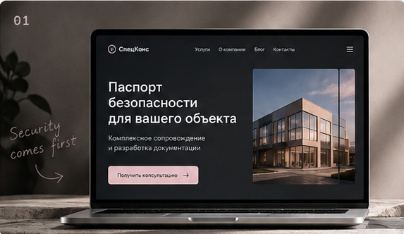
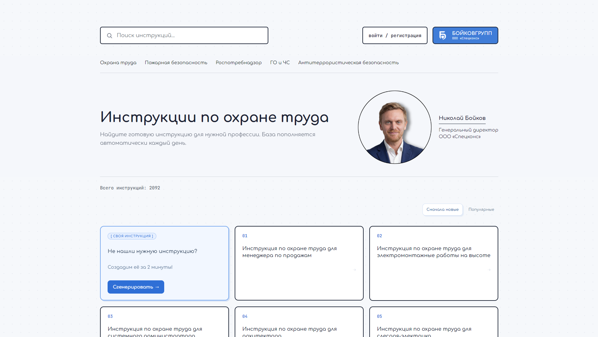

  

<h2 align="center"> Привет! Меня зовут Катя (●'◡'●) </h2>
<h3 align="center">Full-stack разработчица в «СпецКонс» 💻</h3>

## 

<h3>✨ Обо мне</h3>

Пишу код, превращаю идеи в работающие проекты и постоянно учусь чему-то новому.

В IT я с 2021 года: начинала с программирования как хобби, а сегодня занимаюсь реальными проектами и развиваюсь как full-stack разработчица. С 2025 года изучаю фронтенд в Result University и постепенно выхожу за его пределы.

Люблю, когда за хорошим кодом стоит не только логика, но и внимание к деталям — будь то архитектура приложения или пара пикселей в интерфейсе.

А когда закрываю WebStorm, увлекаюсь модой, ищу редкие вещи, вяжу и делюсь красивыми находками в своём Telegram-канале.

♡ На связи: [Telegram](https://t.me/blackpwdr)

## 

<h3 align="left">✨ Технологии</h3>

##

<h3>✨ Избранные проекты
</h3>
Немного того, над чем я работаю: от интерфейсов до полноценных веб-приложений и автоматизации.
  
<table>
<tr>
<td width="50%" valign="top">
  
  <h3>Security Passport</h3>
  Production-сайт с административной панелью, блогом, SSR и SEO-автоматизацией.
  
<code>React</code> <code>Express</code> <code>Vite</code> <code>SSR</code>

  <a href="https://github.com/powder-rose/Security-Passport">Код ↗</a> · <a href="https://pasport-bezopasnosty.ru">Сайт ↗</a>
</td>
<td width="50%" valign="top">
  
  <h3>BoykovDocs</h3>
  Платформа для инструкций по охране труда с поиском, генерацией документов и административной частью.
  
<code>React</code> <code>Node.js</code> <code>Express</code> <code>AI</code>

  <a href="https://github.com/powder-rose/BoykovGroup-instructions">Код ↗</a> · <a href="https://boykovdocs.ru">Сайт ↗</a>
</td>
</tr>
</table>

