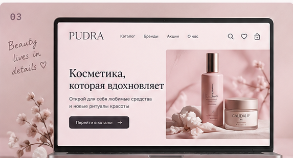

## ✦ Избранные проекты

Немного того, над чем я работаю: от интерфейсов до полноценных веб-приложений и автоматизации.

<table>
<tr>
<td width="50%" valign="top">
  
  <h3>Security Passport</h3>
  Production-сайт с административной панелью, блогом, SSR и SEO-автоматизацией.
  
<code>React</code> <code>Express</code> <code>Vite</code> <code>SSR</code>

  <a href="https://github.com/powder-rose/Security-Passport">Код ↗</a> · <a href="https://pasport-bezopasnosty.ru">Сайт ↗</a>
</td>
<td width="50%" valign="top">
  
  <h3>BoykovDocs</h3>
  Платформа для инструкций по охране труда с поиском, генерацией документов и административной частью.
  
<code>React</code> <code>Node.js</code> <code>Express</code> <code>AI</code>

  <a href="https://github.com/powder-rose/BoykovGroup-instructions">Код ↗</a> · <a href="https://boykovdocs.ru">Сайт ↗</a>
</td>
</tr>
<tr>
<td width="50%" valign="top">
  
  <h3>PUDRA-Shop</h3>
  Учебный проект интернет-магазина косметики.
  
<a href="https://github.com/powder-rose/PUDRA-Shop">Код ↗</a>

</td>
<td width="50%" valign="top">
  
  <h3>Zenbot</h3>
  Бот для автоматизации задач, связанных с Яндекс Дзеном.
  
<a href="https://github.com/powder-rose/Zenbot">Код ↗</a>

</td>
</tr>
</table>
